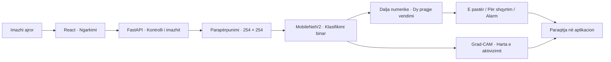

<div align="center">

# Klasifikimi i flakës në imazhe ajrore

### Inteligjencë artificiale për analizën e imazheve të realizuara me dron

**MobileNetV2 · Transferimi i të nxënit · Grad-CAM**


Zhvilluar nga **Arila Behrami**

[Përmbledhje](#përmbledhje) · [Funksionalitetet](#funksionalitetet) · [Rezultatet](#rezultatet) · [Nisja-e-shpejtë](#nisja-e-shpejtë)

</div>

---

## Përmbledhje

Ky projekt paraqet zhvillimin dhe vlerësimin e një modeli për klasifikimin binar të imazheve ajrore të realizuara me dron, sipas pranisë ose mungesës së flakës së dukshme. Modeli mbështetet në arkitekturën **MobileNetV2**, me pesha të paratrajnuara në ImageNet, dhe integrohet në një aplikacion ueb me **React** dhe **FastAPI**.

Zhvillimi dhe vlerësimi u kryen mbi imazhet e bashkësisë së të dhënave **FLAME**. Procesi përfshiu kontrollin dhe korrigjimin e etiketave të një pjese të imazheve, parapërpunimin, zbatimin e ndryshimeve pamore gjatë trajnimit dhe shqyrtimin e rasteve të klasifikuara gabimisht.

> **Objekti i klasifikimit është flaka e dukshme.** Pamjet me tym pa flakë të dukshme përfshihen në klasën negative. Një përgjigje “E pastër” nuk e përjashton praninë e një zjarri të fshehur ose të padukshëm në imazh.

## Funksionalitetet

| Funksionaliteti | Përshkrimi |
| :--- | :--- |
| Ngarkimi i imazheve | Përzgjedhje e një ose disa imazheve për analizë, deri në 10 MB për imazh me konfigurimin fillestar. |
| Klasifikimi automatik | Analizë e pamjes për praninë e flakës së dukshme. |
| Tri zona vendimi | Paraqitja e rezultatit si **E pastër**, **Për shqyrtim** ose **Alarm**. |
| Interpretimi vizual | Hartë aktivizimi përmes Grad-CAM, kur shpjegimi mund të llogaritet. |
| Regjistri i analizave | Ruajtje lokale e regjistrit në shfletues. |
| Gjendja e shërbimit | Kontroll periodik i lidhjes me shërbimin e klasifikimit. |
| Gjurmueshmëria | Përgjigjja e API-së përmban versionin dhe gjurmën SHA-256 të modelit. |

## Arkitektura e sistemit



Shërbimi ndan konfigurimin, rrugët e API-së, logjikën e klasifikimit dhe interpretimin vizual. Modeli ngarkohet gjatë nisjes së API-së; nëse Grad-CAM nuk është i disponueshëm, klasifikimi mund të vazhdojë pa hartën shpjeguese.

## Metodologjia

### Të dhënat dhe etiketimi

| Klasa në skedarë | Kuptimi në këtë projekt |
| :--- | :--- |
| `Fire` | Me flakë të dukshme. |
| `No_Fire` | Pa flakë të dukshme; përfshin edhe pamje vetëm me tym. |

Ndarja e përdorur për modelin e përzgjedhur përmban **26 931 imazhe për trajnim** dhe **7 998 imazhe për validim**. Validimi përfshin 4 985 imazhe me flakë dhe 3 013 pa flakë të dukshme.

Rishikimi pamor i dokumentuar mbulon **201 imazhe**: 66 u korrigjuan nga klasa negative në klasën me flakë, 75 u përfshinë rishtazi dhe 60 ishin tashmë në klasën me flakë. Ky ishte një rishikim i kufizuar; nuk përfaqëson kontroll të plotë të të gjitha etiketave.

### Modeli dhe trajnimi

- **Baza:** MobileNetV2 me pesha ImageNet dhe shtresa të ngrira.
- **Përmbledhja e veçorive:** bashkimi i mesatares dhe maksimumit global.
- **Kreu i klasifikimit:** Dropout 0,35 dhe një neuron me aktivizim sigmoid, me rregullarizim L2.
- **Hyrja:** imazh RGB me madhësi 254 × 254, i ripërmasuar dhe pjesëtuar me 255 sipas konfigurimit të ruajtur.
- **Ndryshimet gjatë trajnimit:** përmbysje horizontale e vertikale, rrotullime dhe ndryshime të ndriçimit e kontrastit.
- **Përzgjedhja:** versioni me saktësinë më të mirë të balancuar në validim; për këtë ekzekutim u përzgjodh epoka 6.

## Rezultatet

<p align="center">
  
</p>

*Figura 1. Rezultatet e modelit të përzgjedhur në validim, në pragun binar 0,5. Grafiku paraqet metrika të matura, jo pamje të ndërfaqes.*

| Metrika | Vlera | Baza e llogaritjes |
| :--- | ---: | :--- |
| Saktësia e balancuar | **86,22%** | Mesatarja e ndjeshmërisë dhe specificitetit. |
| Ndjeshmëria për flakën | **81,20%** | 4 048 nga 4 985 imazhe me flakë. |
| Specificiteti | **91,24%** | 2 749 nga 3 013 imazhe pa flakë. |
| Specificiteti pa pamjet e liqenit | **72,98%** | Nënndarja negative pa pamjet e liqenit, në të njëjtin prag. |

### Matrica e klasifikimit

| Klasa reale ↓ / Parashikimi → | Me flakë | Pa flakë |
| :--- | ---: | ---: |
| **Me flakë** | 4 048 | 937 |
| **Pa flakë** | 264 | 2 749 |

Këto rezultate i përkasin modelit `fire_flame_scene_repair_v1`. Rënia e specificitetit kur përjashtohen pamjet e liqenit tregon se rezultatet varen nga përbërja e klasës negative.

### Kufizimet e vlerësimit

Bashkësia e validimit u përdor edhe për përzgjedhjen e modelit dhe përshtatjen e pragjeve të aplikacionit. Prandaj, **shifrat e raportuara janë rezultate gjatë zhvillimit dhe nuk përfaqësojnë testim të pavarur**. Kuadrot e lidhura dhe regjistrimet e përbashkëta kufizojnë përfundimet për përgjithësimin në regjistrime të reja.

Dalja sigmoid nuk është probabilitet i kalibruar. Grad-CAM paraqet aktivizimin e rrjetit dhe nuk vërteton vendndodhjen e flakës; modeli është trajnuar për klasifikimin e gjithë imazhit.

## Interpretimi i rezultatit në aplikacion

| Zona | Kushti mbi daljen `s` | Interpretimi |
| :--- | :--- | :--- |
| 🟢 **E pastër** | `s < 0.0088` | Dalje nën pragun e poshtëm të vendimit. |
| 🟠 **Për shqyrtim** | `0.0088 ≤ s < 0.9368` | Pamja i nënshtrohet shqyrtimit njerëzor. |
| 🔴 **Alarm** | `s ≥ 0.9368` | Dalje që arrin pragun e alarmit. |

Pragjet janë të rrumbullakosura për paraqitje; API-ja përdor vlerat e ruajtura në konfigurimin e modelit. Ato u përshtatën mbi validimin pa pamjet e liqenit. **Tri zonat janë një mënyrë paraqitjeje dhe vendimmarrjeje mbi daljen e të njëjtit model binar.** Metrikat në tabelën e rezultateve janë llogaritur në pragun 0,5, ndaj nuk duhen ngatërruar me performancën e këtyre tri zonave.

## Nisja e shpejtë

Udhëzimet më poshtë përdorin PowerShell në Windows. Nevojiten Python me mbështetje për TensorFlow dhe Node.js/npm të përputhshëm me Vite 8.

### 1. Merr projektin

```powershell
git clone https://github.com/arilabehrami/uav-wildfire-classification-cnn.git
cd uav-wildfire-classification-cnn
python -m venv .venv
.\.venv\Scripts\python.exe -m pip install -r backend\requirements.txt
```

**Peshat e modelit kërkohen veçmas.** Skedarët `.keras` përjashtohen nga Git. Para nisjes, vendos modelin përkatës në:

```text
backend/artifacts/fire_flame_scene_repair_v1/model.keras
```

Skedari duhet të përputhet me gjurmën SHA-256 në `inference.json`; një kopje e re e depos nuk përmban peshat e modelit dhe as imazhet e bashkësisë së të dhënave.

### 2. Nis shërbimin e klasifikimit

Nga rrënja e projektit:

```powershell
cd backend
..\.venv\Scripts\python.exe -m uvicorn app.main:app --reload
```

- Shërbimi: [http://localhost:8000](http://localhost:8000)
- Dokumentimi ndërveprues: [http://localhost:8000/docs](http://localhost:8000/docs)
- Gjendja e modelit: [http://localhost:8000/health](http://localhost:8000/health)

### 3. Nis ndërfaqen

Në një terminal të dytë, nga rrënja e projektit:

```powershell
cd frontend
npm ci
npm run dev
```

Hap [http://localhost:5173](http://localhost:5173), ngarko një imazh dhe shqyrto rezultatin. Për një adresë tjetër të API-së, përshtat `VITE_API_BASE` sipas shembullit në `frontend/.env.example`.

## API-ja

| Metoda | Rruga | Qëllimi |
| :--- | :--- | :--- |
| `GET` | `/health` | Kontrollon nëse modeli është ngarkuar. |
| `POST` | `/api/classify` | Pranon imazhin në fushën `file` si `multipart/form-data`. |

Shembull kërkese nga PowerShell:

```powershell
curl.exe -X POST http://localhost:8000/api/classify -F "file=@C:\imazhe\pamja.jpg"
```

Përgjigjja përmban `zone`, `fire_score`, `gates`, `model_version`, `model_sha256`, `calibrated` dhe, kur është e disponueshme, `explanation`. Fusha `label` ndjek politikën e shërbimit: zona për shqyrtim gjithashtu nuk pastrohet automatikisht; për paraqitjen e tri zonave përdoret `zone`.

## Struktura e projektit

```text
uav-wildfire-classification-cnn/
├── backend/
│   ├── app/                 # API-ja, shërbimi dhe modeli
│   ├── artifacts/           # Konfigurimet dhe rezultatet e eksperimenteve
│   ├── tests/               # Testet e shërbimit dhe përpunimit
│   └── training/            # Përgatitja e të dhënave dhe trajnimi
├── dataset/
│   └── splits/              # Ndarjet e versionuara të të dhënave
├── docs/images/             # Figurat e dokumentimit
├── frontend/
│   └── src/                 # Ndërfaqja React
└── README.md
```

## Verifikimi i kodit

Nga rrënja e projektit:

```powershell
.\.venv\Scripts\python.exe -m pip install -r backend\requirements-dev.txt
cd backend
..\.venv\Scripts\python.exe -m pytest
```

Për ndërfaqen, nga dosja `frontend`:

```powershell
npm run lint
npm run build
```

Disa teste të integrimit me modelin varen nga disponueshmëria e peshave përkatëse. Kalimi i testeve të softuerit nuk përbën vlerësim të pavarur të performancës së modelit.

## Dokumentimi i eksperimentit

- [Rezultatet dhe rregulli i përzgjedhjes](backend/artifacts/fire_flame_scene_repair_v1/result.json)
- [Konfigurimi i hyrjes, pragjet dhe kufizimet](backend/artifacts/fire_flame_scene_repair_v1/inference.json)
- [Krahasimi i modeleve gjatë zhvillimit](backend/artifacts/fire_flame_scene_repair_v1/comparison.json)
- [Raporti i rishikimit të 201 imazheve](backend/artifacts/flame_label_audit/review_2026-10-20/scene_repair_report.json)

---

<div align="center">

**Arila Behrami** · Projekt akademik për analizën e imazheve ajrore me rrjete nervore konvolucionale

</div>
