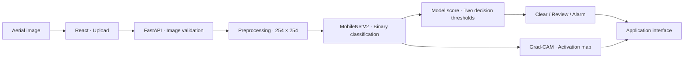
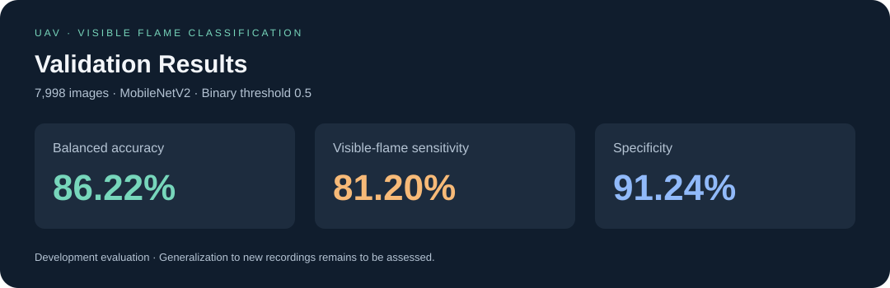

<div align="center">

# Visible Flame Classification in Aerial Images

### Artificial Intelligence for Drone Image Analysis

**MobileNetV2 · Transfer Learning · Grad-CAM**


Developed by **Arila Behrami**

[Overview](#overview) · [Features](#features) · [Results](#results) · [Quick Start](#quick-start)

</div>

---

## Overview

This project presents the development and evaluation of a binary classification model for drone-captured aerial images, based on the presence or absence of visible flames. The model uses **MobileNetV2** with ImageNet-pretrained weights and is integrated into a web application built with **React** and **FastAPI**.

Development and evaluation used images from the **FLAME** dataset. The workflow included reviewing and correcting labels for a subset of images, preprocessing, training-time data augmentation, and examining misclassified examples.

> **The classification target is visible flame.** Images containing smoke without visible flames belong to the negative class. A “Clear” result does not rule out a fire that is obscured or otherwise invisible in the image.

## Features

| Feature | Description |
| :--- | :--- |
| Image upload | Select one or multiple images for analysis, with a default limit of 10 MB per image. |
| Automatic classification | Analyze images for the presence of visible flames. |
| Three decision zones | Present results as **Clear**, **Review**, or **Alarm**. |
| Visual interpretation | Display a Grad-CAM activation map when an explanation can be computed. |
| Analysis history | Store the analysis log locally in the browser. |
| Service status | Periodically check connectivity to the classification service. |
| Traceability | Include the model version and SHA-256 hash in API responses. |

## System Architecture



The service separates configuration, API routes, classification logic, and visual interpretation. The model is loaded during API startup; classification can continue without an explanation map if Grad-CAM is unavailable.

## Methodology

### Dataset and Labeling

| Label in files | Meaning in this project |
| :--- | :--- |
| `Fire` | Visible flames are present. |
| `No_Fire` | No visible flames; includes images containing smoke only. |

The split used for the selected model contains **26,931 training images** and **7,998 validation images**. The validation set includes 4,985 images with visible flames and 3,013 without visible flames.

The documented visual review covers **201 images**: 66 were corrected from the negative class to the visible-flame class, 75 were newly included, and 60 were already labeled as containing flames. This was a limited review rather than a complete audit of all dataset labels.

### Model and Training

- **Backbone:** MobileNetV2 with ImageNet weights and frozen layers.
- **Feature aggregation:** concatenated global average and global max pooling.
- **Classification head:** Dropout of 0.35 and one sigmoid output neuron with L2 regularization.
- **Input:** RGB images resized to 254 × 254 and divided by 255 according to the saved configuration.
- **Data augmentation:** horizontal and vertical flips, rotations, and brightness and contrast adjustments.
- **Selection:** the checkpoint with the highest validation balanced accuracy; epoch 6 was selected for this run.

## Results

<p align="center">
  
</p>

*Figure 1. Validation results for the selected model at a binary threshold of 0.5. The figure presents measured metrics, rather than an application screenshot.*

| Metric | Value | Calculation basis |
| :--- | ---: | :--- |
| Balanced accuracy | **86.22%** | Mean of sensitivity and specificity. |
| Visible-flame sensitivity | **81.20%** | 4,048 of 4,985 images with visible flames. |
| Specificity | **91.24%** | 2,749 of 3,013 images without visible flames. |
| Specificity excluding lake frames | **72.98%** | Negative subset excluding lake frames, at the same threshold. |

### Confusion Matrix

| Actual class ↓ / Prediction → | Visible flame | No visible flame |
| :--- | ---: | ---: |
| **Visible flame** | 4,048 | 937 |
| **No visible flame** | 264 | 2,749 |

These results correspond to `fire_flame_scene_repair_v1`. The lower specificity after excluding lake frames demonstrates the influence of negative-class composition on evaluation results.

### Evaluation Limitations

The validation set was also used for model selection and application threshold tuning. Therefore, **the reported figures are development evaluation results and do not constitute independent testing**. Correlated frames and shared recordings limit conclusions about generalization to new recordings.

The sigmoid output is not a calibrated probability. Grad-CAM visualizes network activation and does not establish the location of a flame; the model was trained for whole-image classification.

## Interpreting Application Results

The following English names translate the decision zones displayed in the application.

| Zone | Condition on score `s` | Interpretation |
| :--- | :--- | :--- |
| 🟢 **Clear** | `s < 0.0088` | The score is below the lower decision threshold. |
| 🟠 **Review** | `0.0088 ≤ s < 0.9368` | The image requires human review. |
| 🔴 **Alarm** | `s ≥ 0.9368` | The score reaches the alarm threshold. |

Thresholds are rounded for presentation; the API uses the values stored in the model configuration. They were tuned on validation data excluding lake frames. **The three zones provide a decision policy over the output of the same binary model.** Metrics in the results table were calculated at a threshold of 0.5 and should not be confused with the performance of this three-zone policy.

## Quick Start

The instructions below use PowerShell on Windows. You need a Python environment compatible with TensorFlow and a Node.js/npm installation compatible with Vite 8.

### 1. Get the Project

```powershell
git clone https://github.com/arilabehrami/uav-wildfire-classification-cnn.git
cd uav-wildfire-classification-cnn
python -m venv .venv
.\.venv\Scripts\python.exe -m pip install -r backend\requirements.txt
```

**Model weights must be provided separately.** The `.keras` files are excluded from Git. Before starting the service, place the corresponding model at:

```text
backend/artifacts/fire_flame_scene_repair_v1/model.keras
```

The file must match the SHA-256 hash in `inference.json`. A fresh clone contains neither the model weights nor the dataset images.

### 2. Start the Classification Service

From the project root:

```powershell
cd backend
..\.venv\Scripts\python.exe -m uvicorn app.main:app --reload
```

- Service: [http://localhost:8000](http://localhost:8000)
- Interactive API documentation: [http://localhost:8000/docs](http://localhost:8000/docs)
- Model status: [http://localhost:8000/health](http://localhost:8000/health)

### 3. Start the Frontend

In a second terminal, from the project root:

```powershell
cd frontend
npm ci
npm run dev
```

Open [http://localhost:5173](http://localhost:5173), upload an image, and inspect the result. To use a different API address, set `VITE_API_BASE` following `frontend/.env.example`.

## API

| Method | Endpoint | Purpose |
| :--- | :--- | :--- |
| `GET` | `/health` | Check whether the model is loaded. |
| `POST` | `/api/classify` | Accept an image in the `file` field as `multipart/form-data`. |

Example request from PowerShell:

```powershell
curl.exe -X POST http://localhost:8000/api/classify -F "file=@C:\images\sample.jpg"
```

The response includes `zone`, `fire_score`, `gates`, `model_version`, `model_sha256`, `calibrated`, and, when available, `explanation`. The `label` field follows the service policy: images in the review zone are also not automatically cleared. Use `zone` to display the three decision zones.

## Project Structure

```text
uav-wildfire-classification-cnn/
├── backend/
│   ├── app/                 # API, service, and model inference
│   ├── artifacts/           # Experiment configurations and results
│   ├── tests/               # Service and preprocessing tests
│   └── training/            # Data preparation and model training
├── dataset/
│   └── splits/              # Versioned dataset splits
├── docs/images/             # Documentation figures
├── frontend/
│   └── src/                 # React interface
└── README.md
```

## Code Verification

From the project root:

```powershell
.\.venv\Scripts\python.exe -m pip install -r backend\requirements-dev.txt
cd backend
..\.venv\Scripts\python.exe -m pytest
```

For the frontend, from the `frontend` directory:

```powershell
npm run lint
npm run build
```

Some model integration tests depend on the availability of the corresponding weights. Passing software tests does not constitute an independent evaluation of model performance.

## Experiment Documentation

- [Results and model selection rule](backend/artifacts/fire_flame_scene_repair_v1/result.json)
- [Input configuration, thresholds, and limitations](backend/artifacts/fire_flame_scene_repair_v1/inference.json)
- [Model comparison during development](backend/artifacts/fire_flame_scene_repair_v1/comparison.json)
- [Visual review report for 201 images](backend/artifacts/flame_label_audit/review_2026-10-20/scene_repair_report.json)

---

<div align="center">
</div>
